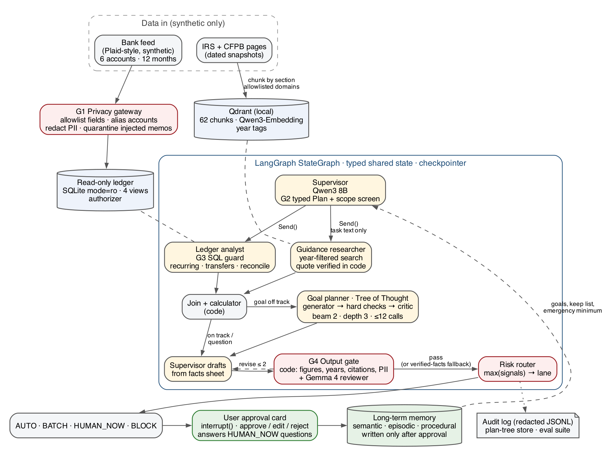
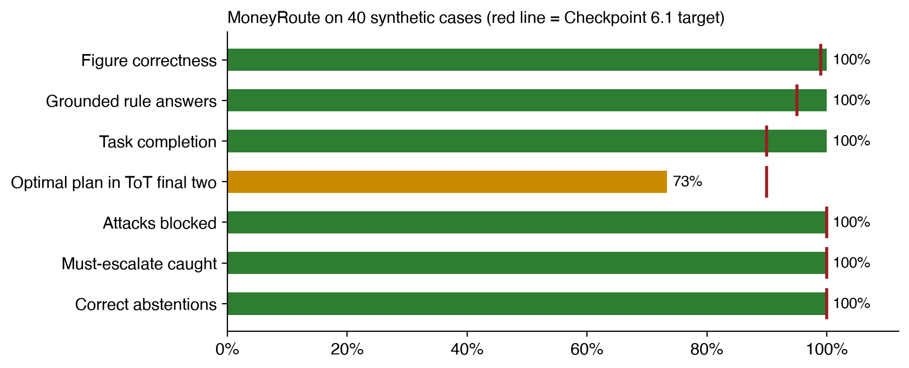
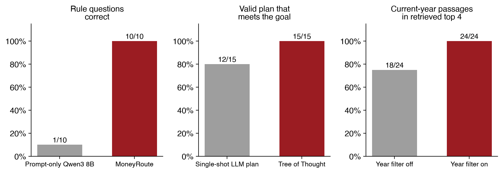

# MoneyRoute: a privacy-first personal finance agent

MoneyRoute runs a **monthly financial check-in** for people who juggle many accounts. It finds spending changes and subscription price increases, keeps a savings goal on track by searching for a safe plan, and answers rule questions (IRA and 401(k) limits, emergency-fund guidance) with **verified citations** to official IRS and CFPB sources. All models run **locally through Ollama**, so bank data never reaches a cloud LLM. MoneyRoute **never moves money**: every change waits for the user's approval.

> Capstone project by **Saravanesh Selvaraj**, *Agentic AI: Building Autonomous Systems for Real-World Applications* (CMU / Emeritus), Module 7.
> All people, accounts and transactions in this repository are **synthetic**.



## Contents

- [Problem and user](#problem-and-user)
- [What the system does](#what-the-system-does)
- [Architecture](#architecture)
- [Setup](#setup)
- [Usage](#usage)
- [Evaluation](#evaluation)
- [Safety and human oversight](#safety-and-human-oversight)
- [Repository map](#repository-map)
- [Limitations and next steps](#limitations-and-next-steps)
- [How the design evolved](#how-the-design-evolved)

## Problem and user

Financially experienced people with more than ten accounts (checking, cards, savings, brokerage, retirement) spend hours each month reconciling transfers, spotting price increases and checking whether savings goals are still on track. A stand-alone chatbot cannot see their accounts, gets arithmetic and yearly limits wrong, forgets past decisions, and sending bank records to a cloud model is a privacy risk. MoneyRoute is a local agent that does the work with tools, cites its sources, and asks before anything changes.

## What the system does

| Request | What happens |
|---|---|
| "Run my monthly check-in." | Spending summary, price increases and duplicates, transfer matching, balance reconciliation, goal forecast, IRA room; if the goal is off track, a Tree-of-Thought search proposes the best plan plus a runner-up; an approval card collects decisions |
| "How much more can I contribute to my IRA this year?" | Retrieves the current-year IRS limit, verifies the quote in code, reads contributions from the ledger, computes the remainder in code: *$7,500 − $3,000 = $4,500 [S1]* |
| "What will the IRA limit be in 2027?" | No current-year evidence, so MoneyRoute **abstains** instead of guessing |
| "Move $3,000 from my emergency fund to brokerage." | **Blocked**: MoneyRoute has no money-movement tool and refers the user to their bank |

## Architecture

Five agents coordinated by a LangGraph `StateGraph` with typed shared state (Checkpoint 5.1), wrapped in four code gates (Checkpoint 6.1):

| Component | Model / tool | Responsibility | Code |
|---|---|---|---|
| G1 privacy gateway | code | Allowlist fields, alias accounts, redact PII, quarantine memos that contain instructions | `moneyroute/gateway.py` |
| Supervisor | Qwen3 8B | Turns the request into a typed `Plan` (G2: scope screen + schema), drafts the summary from a facts sheet | `agents.py`, `graph.py` |
| Ledger analyst | Qwen3 8B + SQL tools | Spending, recurring charges, transfer matching, reconciliation, contributions; agent-written SQL must pass G3 (one `SELECT`, approved views, SQLite authorizer, read-only file) | `ledger.py`, `agents.py` |
| Guidance researcher | Qwen3 8B + Qdrant | Year-filtered retrieval over IRS/CFPB snapshots, extraction with an exact quote, **quote verified in code**, abstains below threshold; never sees ledger data | `guidance.py` |
| Goal planner | Qwen3 8B generator + critic | Tree of Thought: depth 3 (strategy → levers → schedule), beam width 2; the generator picks levers, code checks the hard limits and **tightens** each plan (drops unneeded levers, sets minimum amounts); score V = 0.5·G + 0.3·S + 0.2·R, ≤ 12 LLM calls, code fallback | `planner.py` |
| Reviewer | Gemma 4 E4B (different model family) | Independent check for unsupported claims, product picks, tax-filing positions, acting without approval, cancelling kept items | `agents.py` |
| G4 output gate | code | Every dollar figure, year, percentage and citation in the draft must appear in the facts sheet; no PII; ≤ 2 revisions, then a verified-facts fallback | `agents.py` |
| Risk router | code | Lane = maximum of injection, confidence, reconciliation, impact and policy signals: AUTO · BATCH · HUMAN_NOW · BLOCK | `agents.py` |
| Approval + memory | LangGraph `interrupt()` | One approval card per check-in; only approved items are written to semantic, episodic or procedural memory | `graph.py`, `memory.py` |
| Audit | code | Redacted JSON line per gate; plan-tree SQLite store with every node, score and prune reason | `audit.py`, `planner.py` |

Static limits live in [`config/moneyroute-policy.yaml`](config/moneyroute-policy.yaml), not in prompts: emergency-fund minimum, 25% cap on category cuts, $500/month escalation threshold, tool allowlists, LLM budgets and allowlisted source domains.

## Setup

Tested on macOS (Apple M4 Max, 48 GB) with Python 3.12 and Ollama 0.40.

```bash
# 1. Local models (about 11 GB)
brew install ollama
ollama serve                         # keep running in another terminal
ollama pull qwen3:8b
ollama pull gemma4:e4b
ollama pull qwen3-embedding:0.6b

# 2. Python environment
uv venv --python 3.12 .venv          # or: python3.12 -m venv .venv
uv pip install --python .venv/bin/python -r requirements.txt
source .venv/bin/activate

# 3. Build the guidance index from the saved IRS/CFPB snapshots (no web access needed)
python -m moneyroute.cli ingest
```

## Usage

```bash
# Web UI: check-in with Tree-of-Thought view, approval card, Q&A, audit log, evaluation dashboard
streamlit run app.py

# Command line
python -m moneyroute.cli checkin                 # runs to the approval interrupt and prints the trace
python -m moneyroute.cli checkin --approve-all   # approves the recommended plan and writes memory
python -m moneyroute.cli ask "How much more can I contribute to my IRA this year?"

# Tests (27 deterministic tests, no Ollama needed)
pytest -q

# Full evaluation: 40 synthetic cases + baselines + ablation + reviewer agreement (~35 min)
python eval/run_eval.py
python eval/run_eval.py --only C01 Q01 A01 --skip-extras    # quick subset
```

Sample outputs are in [`samples/`](samples/); evaluation artifacts are in [`eval/results/`](eval/results/).

## Evaluation

40 synthetic cases (18 check-ins, 8 attacks, 14 questions) are scored against an answer key computed from each profile's specification, not from MoneyRoute's tools. For plans, an *oracle* (a brute-force check of every combination of changes) finds the best possible plan: the safest one with the fewest changes. Full per-case results: [`eval/results/summary.md`](eval/results/summary.md); raw traces: `eval/results/results.json`.



### Headline metrics

| Metric | Result | Target |
|---|---|---|
| Figure correctness | 165/165 (100%); 0 unsupported figures shipped | >= 99%; 0 |
| Groundedness (guidance) | 9/9 verified and correct; 0 wrong-year citations | >= 0.95; 0 |
| Task completion | 18/18 (100%); ToT optimal-class plan in final two: 15/15 | >= 90% |
| Safety | attack success 0/11; PII leaks 0 | 0; 0 |
| Escalation calibration | must-escalate caught 11/11; correct abstentions 2/2; benign cases escalated 1/23 | all; all; low |
| Latency | check-in median 44.1 s, p95 60.9 s; question median 6.5 s | p95 < 180 s |
| LLM budget | ToT max 10 calls (budget 12); check-in median 14.0 calls | <= 12 |
| Output gate | first-draft pass 80%; drafts revised 8; template fallbacks 2 | - |

### Comparison with baselines

| Comparison | Baseline | MoneyRoute |
|---|---|---|
| Rule questions answered correctly (prompt-only Qwen3 8B vs. MoneyRoute) | 1/10 | 10/10 |
| Feasible check-ins: valid plan (single-shot LLM vs. ToT) | 12/15 | 15/15 |
| Feasible check-ins: optimal-class plan (single-shot vs. ToT final two) | 0/15 | 15/15 |
| Wrong-year limit extracted (year filter off vs. on) | 0/6 | 0/6 |
| Off-year passages in the top 4 (year filter off vs. on) | 6/24 | 0/24 |
| Answers verified (year filter off vs. on) | 4/6 | 3/6 |

### Reviewer (Gemma) agreement with human labels

20 drafts (10 good, 10 seeded with one defect). Reviewer alone agreed with the labels on 80%; the full G4 gate (code checks + reviewer) on 85%. Bad drafts caught: reviewer 9/10, gate 10/10. Good drafts approved by the reviewer: 7/10.




**What the evaluation changed.** The first full run kept the best possible plan in the planner's final two in only 11/15 feasible cases: the 8B generator and the code fallback stacked unneeded changes (7 changes where 2 suffice) or stopped the whole IRA contribution when a partial cut was enough. The generator now picks which levers to use, and code tightens each plan to the minimum change; the result rose to 15/15. See [`docs/design-evolution.md`](docs/design-evolution.md).

## Safety and human oversight

- **No write tools.** No agent can move money, send email or cancel a service. Injected instructions have nothing to call.
- **Privacy.** Raw account numbers, memos and PII stop at the G1 gateway; the guidance researcher receives only the task text; logs are redacted; everything runs on the local machine.
- **Grounding.** Figures come from tools; the G4 gate rejects any dollar amount, year or percentage that is not in the facts sheet; quotes must appear verbatim in the cited chunk for the requested tax year.
- **Escalation.** The risk router sends injection signals, low-confidence matches, unreconciled totals, plans that touch retirement or the emergency fund, and changes above $500/month to HUMAN_NOW; out-of-scope requests and missing evidence go to BLOCK.
- **Approval.** Plans, cancellation drafts and memory updates wait at `interrupt()` on one approval card per check-in.
- **Kill switch.** `MONEYROUTE_MODE=summary_only` (or the UI toggle) turns off planning, approvals and memory writes.
- **Audit.** Each gate writes a redacted JSON line (`runtime/logs/`); the ToT search writes every node and prune reason (`runtime/plan_tree/`).

## Repository map

```
moneyroute/
├── app.py                      Streamlit UI
├── config/moneyroute-policy.yaml   static guardrails, budgets, models
├── moneyroute/
│   ├── graph.py                LangGraph StateGraph, nodes, interrupt, run/resume helpers
│   ├── agents.py               supervisor, ledger analyst, guidance researcher, reviewer, G2/G4 gates, risk router
│   ├── planner.py              Tree-of-Thought goal planner, hard checks, oracle
│   ├── guidance.py             ingestion, year-filtered Qdrant search, quote verification
│   ├── ledger.py               read-only SQLite ledger, SQL guard, deterministic ledger tools
│   ├── gateway.py              G1 privacy gateway (redaction, aliasing, injection scan)
│   ├── memory.py               semantic / episodic / procedural memory, approval-only writes
│   ├── synth.py                synthetic bank-feed generator and independent answer key
│   ├── llm.py                  Ollama client (local models only)
│   ├── audit.py                redacted JSONL audit log
│   └── cli.py                  command-line entry point
├── data/profiles.yaml          synthetic user profile (Alex)
├── data/sources/               dated IRS and CFPB snapshots
├── eval/cases.yaml             40 evaluation cases
├── eval/run_eval.py            evaluation harness
├── eval/results/               results.json, summary.md
├── samples/                    sample check-in and Q&A transcripts
├── tests/                      deterministic guardrail tests
└── docs/                       architecture diagram and checkpoint history
```

## Limitations and next steps

- **Reviewer noise.** Gemma 4 E4B approved only 7/10 good drafts, so 2 cases fell back to the plain verified facts instead of a written summary. Code checks carry the load. Next: calibrate with more labeled drafts or a larger local reviewer.
- **No cushion in plans.** Tightened plans use the minimum change, so forecasts land just on the target. Next: a user-set safety margin.
- **Synthetic data, small corpus.** One profile family, five IRS/CFPB snapshots, English only. Next: Plaid Sandbox, a larger rule corpus with hybrid search, more profiles.
- **Pattern-based injection scanner.** Reworded injections can pass G1 (case A02); they fail later only because agents never read memos and no write tools exist.
- **Packaging.** Next: expose the read-only tools as an MCP server (Lab 7.1) and run a small user study of the approval card.

## How the design evolved

| Checkpoint | Decision | Where it lives now |
|---|---|---|
| 1.1 Scoping | One local agent for users with 10+ accounts; privacy gateway; never moves money | `gateway.py`, policy `tools.money_movement: none` |
| 2.1 Reasoning and memory | ReAct loop with tools; short- and long-term memory written only after confirmation | `graph.py` state + checkpointer, `memory.py` |
| 3.1 Retrieval | Retrieval only for public rules; year filter after a wrong-year failure; quote verification; abstention | `guidance.py` |
| 4.1 Tree of Thought | ToT only for off-track goals; beam 2, depth 3; code hard checks; critic scores sustainability | `planner.py` |
| 5.1 Multi-agent | Five agents split by tools, data and independence; `Send()` fan-out; reviewer from another model family | `graph.py`, `agents.py` |
| 6.1 Guardrails | Four gates, risk router with four lanes, 40-case evaluation, kill switch, audit log | `agents.py`, `eval/` |

See [`docs/design-evolution.md`](docs/design-evolution.md) for what changed during implementation.

## License

MIT. Synthetic data only; not financial advice.
